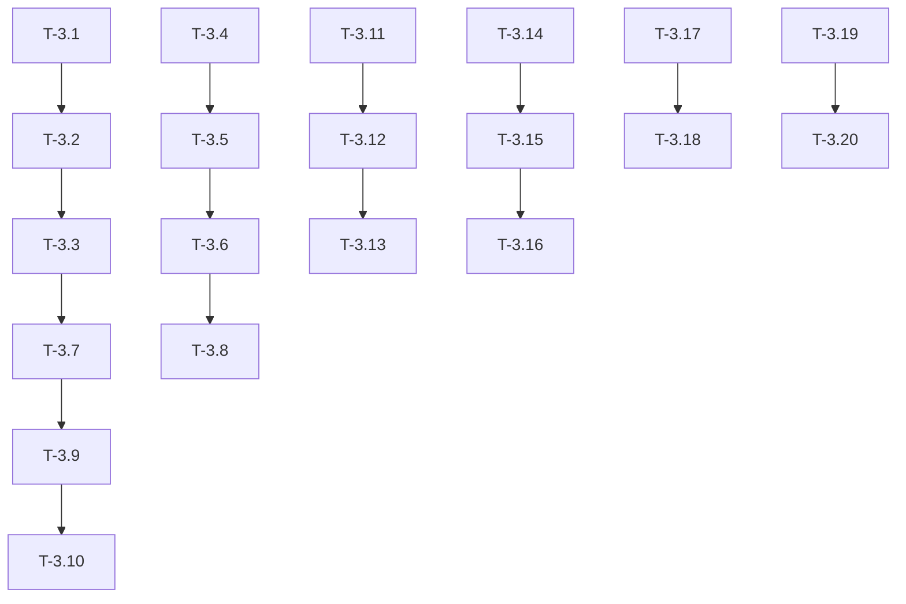

# PortfolioX - Phase 3 Tasks Documentation (Tasks.md)

## Document Information

- **Document Name**: Tasks.md
- **Feature**: Groww Import System (Phase 3)
- **Status**: Draft
- **Related PRD**: PRD.md

## 1. Task Overview

This document breaks down the Groww Import System (Phase 3) into implementable tasks based on the requirements in PRD.md. Tasks are organized by feature area and include estimated effort and dependencies.

## 2. Task Categories

### 2.1 CSV Parsing Tasks

| Task ID | Title | Description | Priority | Estimated Effort |
|---------|-------|-------------|----------|------------------|
| T-3.1 | Parse Groww CSV tradebook format | Implement CSV reader using Python csv module or pandas | High | 2 days |
| T-3.2 | Handle CSV dialect variations | Support different CSV formatting (comma/tab delimited, quoted fields) | Medium | 1 day |
| T-3.3 | Validate CSV column headers | Verify required columns exist in uploaded file | High | 1 day |

### 2.2 XLSX Parsing Tasks

| Task ID | Title | Description | Priority | Estimated Effort |
|---------|-------|-------------|----------|------------------|
| T-3.4 | Parse Groww XLSX tradebook format | Implement XLSX reader using openpyxl or xlrd | High | 2 days |
| T-3.5 | Handle multiple sheets | Support XLSX files with multiple worksheets | Medium | 1 day |
| T-3.6 | Extract data from XLSX rows | Parse row data and convert to structured format | High | 1 day |

### 2.3 Data Validation Tasks

| Task ID | Title | Description | Priority | Estimated Effort |
|---------|-------|-------------|----------|------------------|
| T-3.7 | Validate date formats | Support DD-MM-YYYY, MM/DD/YYYY, YYYY-MM-DD | Medium | 2 days |
| T-3.8 | Validate numeric fields | Validate quantity and price are positive numbers | High | 1 day |
| T-3.9 | Validate required fields | Check symbol, date, quantity, price, trade type | High | 1 day |
| T-3.10 | Validate trade type | Ensure trade type is "Intraday" or "Delivery" | Medium | 1 day |

### 2.4 Data Mapping Tasks

| Task ID | Title | Description | Priority | Estimated Effort |
|---------|-------|-------------|----------|------------------|
| T-3.11 | Map Groww columns to database schema | Create mapping dictionary for Groww → PortfolioX fields | High | 1 day |
| T-3.12 | Type conversion | Convert parsed types to database-compatible types | High | 1 day |
| T-3.13 | Handle missing optional fields | Manage columns that may or may not be present | Medium | 1 day |

### 2.5 Idempotent Import Tasks

| Task ID | Title | Description | Priority | Estimated Effort |
|---------|-------|-------------|----------|------------------|
| T-3.14 | Check for existing transactions | Query database to find previously imported transactions | High | 2 days |
| T-3.15 | Implement skip logic | Skip rows that already exist based on symbol+date+qty | High | 1 day |
| T-3.16 | Track import history | Log import sessions with success/failure counts | Medium | 2 days |

### 2.6 Reporting Tasks

| Task ID | Title | Description | Priority | Estimated Effort |
|---------|-------|-------------|----------|------------------|
| T-3.17 | Generate import summary report | Create summary with success/failure counts | Medium | 1 day |
| T-3.18 | List failed rows with reasons | Provide details on why rows failed validation | Medium | 2 days |

### 2.7 Error Handling Tasks

| Task ID | Title | Description | Priority | Estimated Effort |
|---------|-------|-------------|----------|------------------|
| T-3.19 | User-friendly error messages | Display clear error messages for invalid data | High | 1 day |
| T-3.20 | Graceful degradation | Continue processing valid rows when some fail | Medium | 1 day |

## 3. Task Dependencies

## 4. Implementation Priority Order

### Sprint 1 (Week 1-2)
- [ ] T-3.1: Parse Groww CSV tradebook format
- [ ] T-3.4: Parse Groww XLSX tradebook format
- [ ] T-3.11: Map Groww columns to database schema
- [ ] T-3.14: Check for existing transactions
- [ ] T-3.19: User-friendly error messages

### Sprint 2 (Week 3-4)
- [ ] T-3.2: Handle CSV dialect variations
- [ ] T-3.5: Handle multiple sheets
- [ ] T-3.7: Validate date formats
- [ ] T-3.8: Validate numeric fields
- [ ] T-3.10: Validate trade type
- [ ] T-3.15: Implement skip logic
- [ ] T-3.17: Generate import summary report

### Sprint 3 (Week 5-6)
- [ ] T-3.3: Validate CSV column headers
- [ ] T-3.6: Extract data from XLSX rows
- [ ] T-3.9: Validate required fields
- [ ] T-3.12: Type conversion
- [ ] T-3.13: Handle missing optional fields
- [ ] T-3.16: Track import history
- [ ] T-3.18: List failed rows with reasons
- [ ] T-3.20: Graceful degradation

## 5. Definition of Done

For each task to be considered complete, the following must be satisfied:

- [ ] Task code is written and tested
- [ ] Edge cases are handled
- [ ] Error messages are user-friendly
- [ ] Code follows project coding conventions
- [ ] Unit tests are written (minimum 80% coverage for task logic)
- [ ] Integration test with database layer passes
- [ ] Documentation is updated

## 6. Ready for Handoff

When all Sprint 1, Sprint 2, and Sprint 3 tasks are complete, the Phase 3 Groww Import System will be ready for:
- UI integration (Phase 5)
- Testing with sample Groww tradebooks
- Production deployment